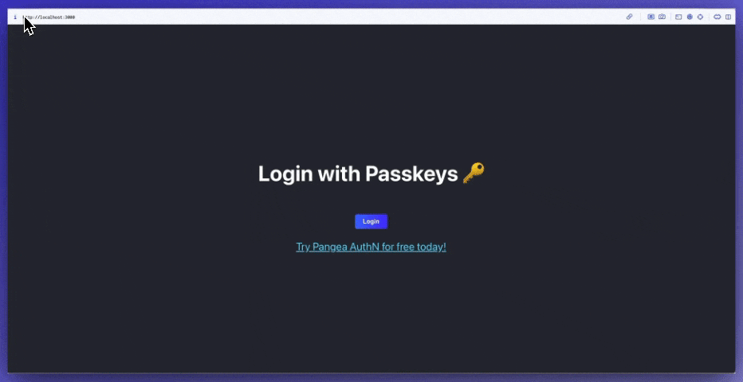

# ReactJS "Login with Passkey" template

This repository is a template that uses [Pangea AuthN](https://pangea.cloud/docs/authn) to enable Passkey based authentication in < 2mins

## Setup Instructions

### Step 1: Create an account on [pangea.cloud](https://console.pangea.cloud/?utm_source=github&utm_medium=react-authn-passkeys-template) and copy tokens into `.env.local` file
After signing up for a Pangea account enable the AuthN service, rename the `.env.example` file to `.env.local` or run the following command
```bash
mv .env.example .env.local
```
Open up the `.env.local` file and copy and paste in the appropriate tokens from the Pangea AuthN service dashboard
```
REACT_APP_LOGIN_URL="<YOUR_PROJECT_HOSTED_LOGIN_URL>"
REACT_APP_CLIENT_TOKEN="<YOUR_PROJECT_CLIENT_TOKEN>"
REACT_APP_PANGEA_DOMAIN="<YOUR_PANGEA_DOMAIN>"
```


### Step 2: Add Authorized Redirect and enable Passkeys Auth Method in Pangea console
Since we’re using a React SPA (single page application), we need to add an authorized redirect, so that Pangea’s AuthN hosted pages can successfully redirect us back to the http://localhost:3000/ when a user is done authenticating.

First, let’s go under `General > Redirect (Callback) Settings` and add `http://localhost:3000/` as a redirect and save it.

Then, enable Passkeys. Go to `Single Sign On > Passkeys` and enable it. Optionally you can choose to enable fallback authentication options based on your desired user experience.

Here’s a quick video on how you can enable it in [Pangea console settings](https://youtu.be/M2kPx1WteEE).

### Step 3: Run dev server
Install the required npm packages
```
npm install
# or
yarn install
```
Start dev server
```
npm run dev
```

## Watch in Action ✨


To understand the inner workings of this app, refer to this [blog](https://pangea.cloud/blog/add-passkeys-to-reactjs-in-2mins/?utm_source=github&utm_medium=reactjs-passkeys-readme).
